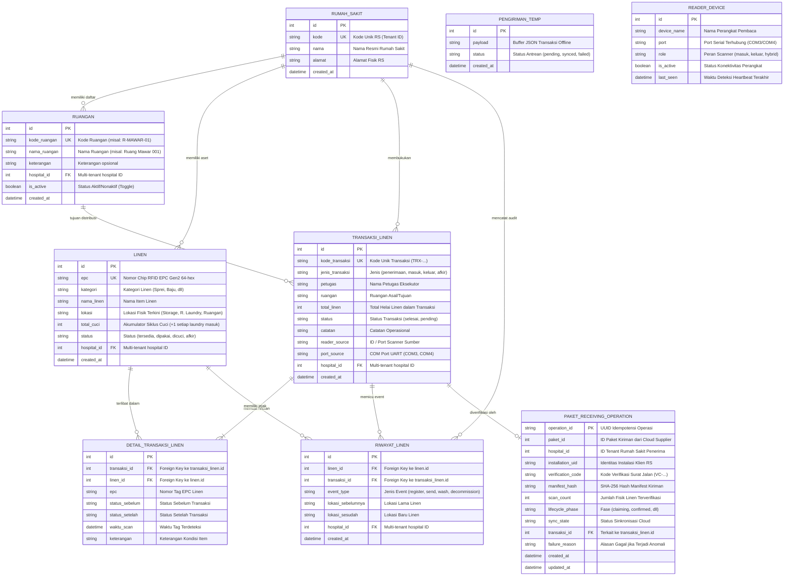
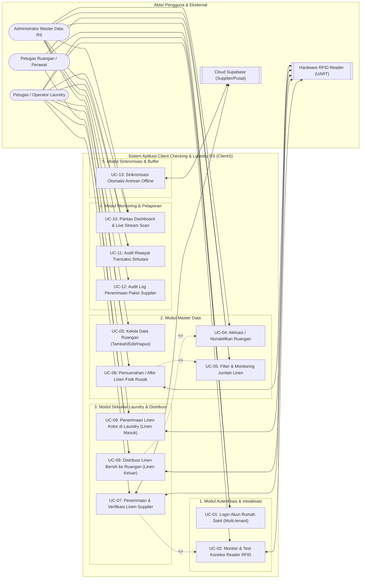

# 📊 Entity Relationship Diagram (ERD) & Use Case Diagram
## *Sistem Informasi Client Tracking & Laundry Linen RS (ClientS)*

Dokumen ini memuat dokumentasi arsitektur data (**Entity Relationship Diagram / ERD**) dan analisis fungsional sistem (**Use Case Diagram & Spesifikasi Use Case**) untuk aplikasi **Client Checking & Laundry Linen RS (`ClientS`)**.

---

## 🗄️ 1. Entity Relationship Diagram (ERD)

### 1.1 Diagram ERD Konseptual & Relasional
Model data berikut merefleksikan basis data SQLite lokal (`Client_RumahSakit_Template.db`) yang mendukung operasi *Offline-First* serta isolasi multi-tenant rumah sakit.

---

### 1.2 Penjelasan Entitas & Kardinalitas (Data Dictionary)

| Entitas | Deskripsi & Aturan Integritas | Hubungan / Kardinalitas |
| :--- | :--- | :--- |
| **`rumah_sakit`** | Menyimpan identitas tenant rumah sakit. Memastikan pemisahan data antar-faskes (*Tenant Isolation*). | **1 to N** terhadap `linen`, `ruangan`, `transaksi_linen`, dan `riwayat_linen`. |
| **`ruangan`** | Master lokasi ruangan rawat inap, poliklinik, dan penunjang medis. Memiliki atribut `is_active` (toggle). Ruangan nonaktif otomatis disembunyikan dari dropdown distribusi. | **1 to N** terhadap `transaksi_linen` (*Safe Delete*: Ruangan tidak bisa dihapus jika ada linen atau transaksi aktif). |
| **`linen`** | Aset fisik kain linen yang dipasangi tag RFID UHF. Menyimpan status siklus (`tersedia`, `dipakai`, `dicuci`, `afkir`) dan akumulasi cuci (`total_cuci`). | **1 to N** terhadap `detail_transaksi_linen` dan `riwayat_linen`. |
| **`transaksi_linen`** | Header batch aktivitas sirkulasi linen (penerimaan baru, distribusi keluar ruangan, laundry kotor masuk, dan pemusnahan afkir). | **1 to N** terhadap `detail_transaksi_linen` dan `riwayat_linen`. |
| **`detail_transaksi_linen`** | Baris rincian per helai tag RFID yang diproses dalam suatu transaksi batch beserta snapshot status sebelum dan sesudah. | Menghubungkan **M to N** antara `transaksi_linen` dan `linen`. |
| **`riwayat_linen`** | Buku besar (*immutable audit trail*) perpindahan fisik dan perubahan status setiap linen dari awal registrasi hingga afkir. | Pencatatan audit histori pergerakan setiap helai linen. |
| **`paket_receiving_operation`** | Pengendali status idempotensi penerimaan kiriman paket supplier. Mencegah satu kode verifikasi diproses ganda. | **1 to 1** dengan transaksi jenis penerimaan. |
| **`pengiriman_temp`** | Buffer antrean transaksi saat internet terputus (*Offline-First*). Otomatis dikirim ke cloud saat internet kembali pulih. | Entitas antrean internal (*queue*). |
| **`reader_device`** | Menyimpan konfigurasi hardware reader RFID serial UART (COM port, baudrate, mode aktif/standby). | Entitas manajemen perangkat keras. |

---

## 🎯 2. Use Case Diagram

### 2.1 Diagram Use Case Sistem
Diagram use case di bawah memetakan interaksi 4 aktor (Petugas Laundry, Petugas Ruangan, Administrator RS, dan Sistem/Hardware Eksternal) dengan seluruh modul sistem ClientS.

---

### 2.2 Tabel Spesifikasi Use Case Terperinci

| Kode UC | Nama Use Case | Aktor Terlibat | Deskripsi Singkat & Alur Utama |
| :--- | :--- | :--- | :--- |
| **UC-01** | **Login Akun Rumah Sakit** | Petugas Laundry, Perawat, Admin | Petugas memasukkan Kode RS (Tenant ID), Username, dan Password. Sistem memvalidasi kredensial dan mengunci sesi kerja hanya untuk data rumah sakit tersebut. |
| **UC-02** | **Monitor & Test Koneksi Reader** | Petugas Laundry, Hardware RFID | Sistem memeriksa port serial UART (`COM3`/`COM4`). Menampilkan indikator *CONNECTED* / *DISCONNECTED* dan menyediakan tombol *Test Connection*. |
| **UC-03** | **Kelola Master Ruangan** | Administrator RS | Menambah ruangan baru, mengedit nama/kode, atau menghapus ruangan dengan proteksi *Safe Delete* (ruangan berelasi tidak dapat dihapus sembarangan). |
| **UC-04** | **Aktivasi / Nonaktifkan Ruangan** | Administrator RS | Mengubah status ruangan menjadi Aktif atau Nonaktif. Ruangan nonaktif otomatis disembunyikan dari dropdown distribusi linen keluar tanpa menghapus data historisnya. |
| **UC-05** | **Filter & Monitoring Data Linen** | Perawat, Petugas Laundry, Admin | Menyaring linen berdasarkan Kategori, Pencarian Nama/EPC, Lokasi Ruangan, dan Siklus Cuci (<15x baru, 15-49x normal, 50-99x waspada, ≥100x kritis) dengan 4 live counter badges. |
| **UC-06** | **Pemusnahan / Afkir Linen Fisik** | Petugas Laundry, Admin, Hardware RFID | **Wajib scan fisik RFID** pada linen rusak. Sistem memvalidasi kepemilikan tag di RS, meminta alasan pemusnahan & nama petugas, lalu mengunci tag permanen dari transaksi cuci/pakai. |
| **UC-07** | **Penerimaan Linen Baru Supplier** | Petugas Laundry, Hardware RFID, Cloud Supabase | Memasukkan kode verifikasi surat jalan vendor (`VC-...`), mengambil manifest cloud, scan fisik linen baru, memetakan linen terdaftar vs tidak terdaftar, dan menyimpan secara atomik ke DB lokal. |
| **UC-08** | **Distribusi Linen Bersih (Keluar)** | Petugas Laundry, Perawat, Hardware RFID | Scan tumpukan linen bersih di troli, memilih ruangan tujuan (hanya ruangan aktif), memasukkan nama pengirim, dan memperbarui status linen menjadi `dipakai`. |
| **UC-09** | **Penerimaan Linen Kotor (Masuk)** | Petugas Laundry, Hardware RFID | Scan kantong/troli linen kotor, memproses masuk ke `R. Laundry`, memperbarui status menjadi `dicuci`, dan **menambah akumulasi siklus cuci (+1)** secara otomatis. |
| **UC-10** | **Pantau Dashboard & Live Stream** | Seluruh Petugas, Admin | Memantau ringkasan metrik total linen, linen dicuci, linen dipakai, grafik donut perbandingan rasio, live stream pembacaan antena, dan 5 riwayat aktivitas terkini. |
| **UC-11** | **Audit Riwayat Transaksi** | Petugas Laundry, Admin | Menampilkan log harian linen masuk dan keluar, beserta rincian nomor EPC dan riwayat jumlah cuci setiap helai linen per transaksi. |
| **UC-12** | **Audit Log Penerimaan Supplier** | Administrator RS | Meninjau arsip riwayat paket kiriman supplier yang pernah diterima beserta manifest itemnya. |
| **UC-13** | **Sinkronisasi Antrean Offline** | Background Worker, Cloud Supabase | Saat internet terputus (*offline*), seluruh transaksi disimpan di tabel lokal `pengiriman_temp`. Begitu internet online kembali, sistem otomatis mengirimkan data ke tabel cloud `sync_events`. |

